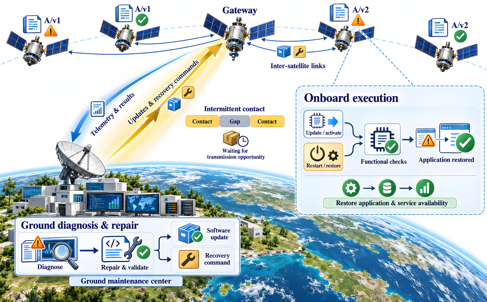
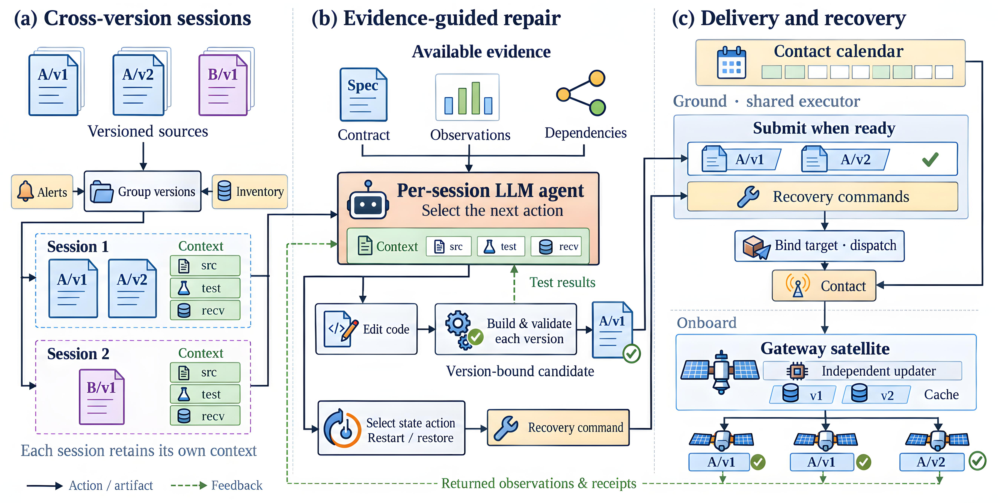

# SatMend

[中文文档](README.zh-CN.md) · [Quick start](#quick-start) · [MIT License](LICENSE)



*Ground maintenance reaches applications on multiple satellites through a gateway and scheduled contact windows.*

A constellation may run several versions of the same software component across cooperating satellites. When a fault interrupts a service, maintainers need to prepare a compatible repair, deliver it through limited contacts, and verify that the target has recovered before the maintenance deadline. A healthy application can also lose service when its upstream dependency fails.

SatMend provides a discrete-event simulator and a reference maintenance workflow. Use it to compare contact calendars, link capacities, deployment layouts, candidate release times, and recovery strategies on scenarios you define. The simulator reports when applications recover, when dependent services become available, and when confirmation reaches the ground.

## Method



*SatMend groups related versions into ground repair sessions, validates each version separately, and submits each candidate when ready.*

The [reference planner](satmend/method.py) groups affected versions by component and assigns each group to a repair slot. It models the reuse of diagnostic work across versions, evaluates each code version separately, and emits timed actions for code delivery or state recovery. The [simulator](satmend/simulator.py) executes those actions through a shared model of uplink, gateway staging, crosslink forwarding, activation, verification, and receipts. An `Assessment` callback supplies scenario-specific validation outcomes and costs. You can also provide a complete action sequence from your own planner.

## Quick start

Clone the repository and run the example with Python 3.9 or later. The simulator uses the Python standard library.

```bash
git clone https://github.com/luopeng69131/SatMend.git
cd SatMend
mkdir -p outputs
python3 -m satmend prepare examples/scenario.json \
  --contacts examples/ground_contacts.csv --output outputs/scenario.json
python3 -m satmend run outputs/scenario.json --output outputs/result.json
python3 -c 'import json; print(json.load(open("outputs/result.json"))["summary"])'
```

The example has three satellites and two ground contacts. The gateway recovers first. Two replicas then finish verification during the disconnection, and their receipts reach the ground at the next contact. A later version's partial uplink resumes with 20 bytes remaining.

```text
{'deadline_s': 22.0, 'faulty_applications': 4, 'recovered_applications': 4, 'affected_services': 5, 'restored_services': 5, 'mean_service_outage_s': 10.14}
```

To install the `satmend` command and Python package in a virtual environment:

```bash
python3 -m venv .venv
source .venv/bin/activate
python -m pip install .
satmend --help
```

## Configure an experiment

Copy [the scenario JSON](examples/scenario.json) and adjust the fields below. Time is in seconds and link rates are in bytes per second.

| Input | What it controls |
| --- | --- |
| `deadline_s`, `ground_contacts` | Experiment horizon and ground contact windows |
| `gateway_satellite`, `gateway_app`, `crosslink_contacts` | Gateway placement, forwarding health, and optional visibility windows per destination satellite |
| `*_bytes_per_s`, `command_bytes`, `receipt_bytes` | Ground uplink and downlink capacity, one shared crosslink capacity, and control-message sizes |
| `applications` | Satellite, component, version, initial fault, upstream application IDs, package size, activation time, and verification time |
| `--slots`, `--diagnosis-s`, `--reuse-diagnosis-s`, `--validation-s`, `--state-recovery-s` | Reference planner's concurrency and timing |
| `--actions` | A JSON array of explicit actions. Use `planned_actions` from a result file as a template. |

The [data loader](satmend/scenario.py) validates IDs, the dependency graph, times, and capacities. It sorts and merges contacts, and the `prepare` command writes the normalized scenario. An optional CSV with `start_s,end_s` columns replaces the JSON ground calendar. For crosslinks, an omitted destination has continuous visibility when the gateway is healthy, and an empty list gives that destination no visibility. Set each code fault's `package_bytes` to a positive integer.

Ground transfers can run inside contact windows and resume with their remaining bytes. A package staged at the gateway can proceed to a target while ground contact is unavailable. The simulator caches each compatible code package once at the gateway and schedules per-target delivery over a shared crosslink that requires healthy forwarding. It models activation and verification with configured durations and outcomes. A verified result at the deadline counts as recovered.

The result JSON contains `summary`, per-target `applications`, individual `jobs`, `pending_transfers`, timestamped `events`, and the input `planned_actions`. Recovery time, ground receipt time, and dependent service availability are separate. Mean service outage is computed over services affected at the start, with an unrestored service contributing the full experiment duration.

## Use from Python

```python
from satmend import Assessment, load_scenario, plan_sessions, simulate

scenario = load_scenario("examples/scenario.json")

def assess(component, version, targets):
    return Assessment(validated=True, verification_passes=True, duration_s=1.5)

actions = plan_sessions(scenario, slots=2, assess=assess)
report = simulate(scenario, actions)
print(report["summary"])
```

Set the callback to model validation costs and outcomes for each code version, or construct `Action` objects directly to compare maintenance policies. A code action supplies its ready time, target IDs, component, version, candidate ID, package size, and check outcomes. A state action supplies its ready time and target IDs. See the [action and planner definitions](satmend/method.py) for defaults.

The code, documentation, synthetic examples, and project illustrations are available under the [MIT License](LICENSE). [Asset sources](ASSET_SOURCES.md)
