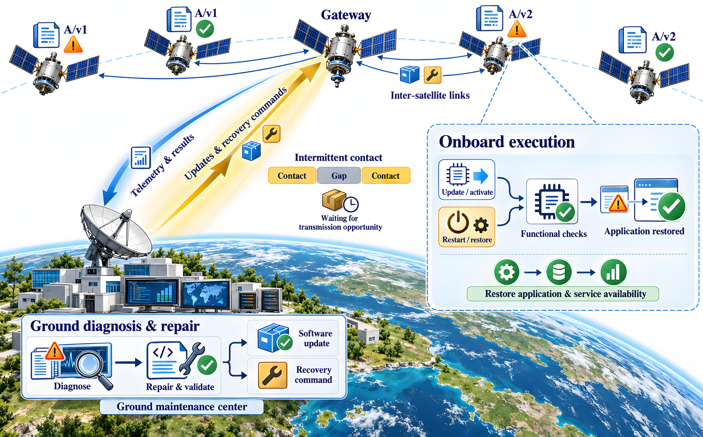
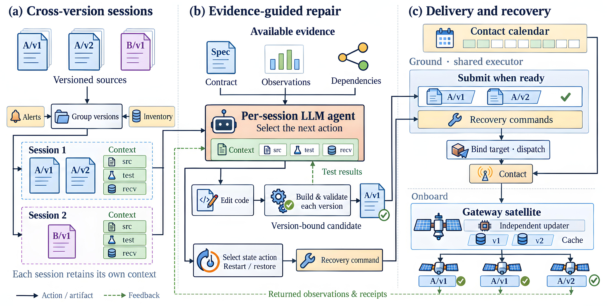

<div align="center">

# SatMend

**间歇星地联系下的卫星星座软件恢复**

[](https://www.python.org/)
[](LICENSE)

**[English](README.md) · 简体中文**

[快速开始](#快速开始) · [方法流程](#方法流程) · [仿真器](#配置仿真器)

</div>

<p align="center"></p>
<p align="center"><sub>同一联系窗口内，地面可通过网关卫星维护多个星上应用。</sub></p>

## 为什么需要 SatMend？

同一星座内可能运行同一组件的多个版本，应用之间还会跨星依赖。当应用异常时，地面必须利用有限的联系窗口将修复交付到兼容版本，并在目标上验证恢复。应用本身即使健康，也可能因上游依赖异常而无法提供服务。

**SatMend 将地面修复准备与星上恢复协调起来。** 本仓库支持对这一过程建模，并比较不同维护策略。

- **离散事件仿真器**：建模间歇联系、断点续传、网关转发和服务依赖。
- **参考规划器**：组织跨版本修复会话，逐版本验证，候选就绪即提交。
- **场景输入与结果记录**：配置实验，检查应用恢复、服务可用和地面回执的时刻。

## 快速开始

### 获取示例

使用 Python 3.9 或更新版本。示例只需要 Python 标准库。

```bash
git clone https://github.com/luopeng69131/SatMend.git
cd SatMend
mkdir -p outputs
```

### 运行仿真

```bash
python3 -m satmend run examples/scenario.json \
  --contacts examples/ground_contacts.csv \
  --output outputs/result.json
python3 -c 'import json; print(json.load(open("outputs/result.json"))["summary"])'
```

在这个三卫星场景中，网关首先恢复，两个载荷应用副本在断联期间完成星上验证。地面在下一个联系窗口收到确认。

| 22 秒截止时的示例结果 | 数值 |
| --- | ---: |
| 已恢复故障应用 | **4 / 4** |
| 已恢复受影响服务 | **5 / 5** |
| 受影响服务平均中断时长 | **10.14 秒** |

<details>
<summary><b>安装 satmend 命令</b></summary>

```bash
python3 -m venv .venv
source .venv/bin/activate
python -m pip install .
satmend --help
```

</details>

## 方法流程

<p align="center"></p>

1. **按组件组织修复会话。** 将相关版本分配到同一个地面修复工作槽，复用诊断上下文。
2. **逐版本验证。** 为各版本设置验证耗时与结果，在候选就绪时提交动作。状态恢复动作携带恢复命令。
3. **交付并验证恢复。** 利用联系窗口把候选与命令暂存至网关，转发至兼容目标，记录星上验证与地面回执。

[参考规划器](satmend/method.py)描述准备和验证的时间过程。[仿真器](satmend/simulator.py)按配置的时间与结果建模交付、激活和目标验证。

## 配置仿真器

可从[场景 JSON](examples/scenario.json)与[联系窗口 CSV](examples/ground_contacts.csv)开始修改。时间单位为秒，链路速率为字节每秒。

| 调整内容 | 配置位置 |
| --- | --- |
| 维护期限与星地联系窗口 | `deadline_s`、`ground_contacts` 或 `--contacts` |
| 网关、星间可见性和链路容量 | `gateway_satellite`、`gateway_app`、`crosslink_contacts` 和 `*_bytes_per_s` |
| 应用部署、版本、故障和服务依赖 | `applications` |
| 修复包与控制消息大小、激活和验证耗时 | 应用的 `package_bytes`、`activation_s`、`verification_s`，以及场景的 `command_bytes` 和 `receipt_bytes` |
| 地面修复工作槽与准备耗时 | `--slots`、`--diagnosis-s`、`--reuse-diagnosis-s`、`--validation-s` 和 `--state-recovery-s` |

<details>
<summary><b>预处理场景数据与联系窗口</b></summary>

```bash
python3 -m satmend prepare examples/scenario.json \
  --contacts examples/ground_contacts.csv \
  --output outputs/scenario.json
```

可选 CSV 提供 `start_s,end_s`，用于替换 JSON 中的星地联系日历。[数据加载器](satmend/scenario.py)检查编号、时间、容量和无环依赖，再排序和合并联系窗口。未配置星间窗口的目标在网关健康时持续可见，显式空列表表示不可见。代码故障需要正整数的 `package_bytes`。

链路中断后保留剩余字节供续传。修复包和命令完整到达网关后，可在星地断联期间继续转发。网关缓存每个兼容修复包，通过共享星间链路逐目标交付。恰好在截止时通过验证也计入恢复。

</details>

结果 JSON 包含总体 `summary`、逐目标 `applications`、逐项 `jobs`、未完成的 `pending_transfers`、事件时间线 `events` 和 `planned_actions`。应用恢复、依赖服务可用和地面确认分别记录。未恢复服务的中断时长按整个实验时段计入平均值。

## 接入自己的规划器

通过 `--actions path/to/actions.json` 导入自定义动作序列。可用示例结果中的 `planned_actions` 作为模板。若要单独调整参考规划器的逐版本验证结果与成本，可提供 `Assessment` 回调。

<details>
<summary><b>Python 示例</b></summary>

```python
from satmend import Assessment, load_scenario, plan_sessions, simulate

scenario = load_scenario("examples/scenario.json")

def assess(component, version, targets):
    return Assessment(validated=True, verification_passes=True, duration_s=1.5)

actions = plan_sessions(scenario, slots=2, assess=assess)
print(simulate(scenario, actions)["summary"])
```

代码动作包含就绪时间、目标、组件、版本、候选编号、包大小和验证结果。状态动作包含就绪时间和目标。详见 [Action 和 Assessment 定义](satmend/method.py)。

</details>

[MIT 许可证](LICENSE) · [资产来源](ASSET_SOURCES.md)
